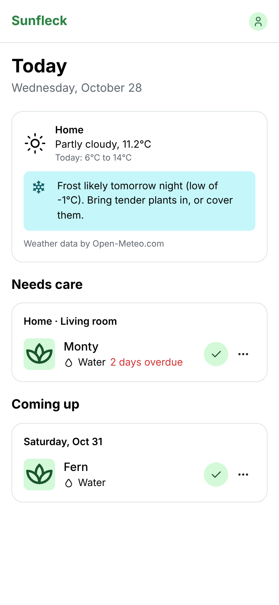
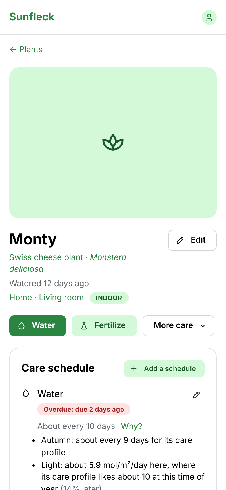
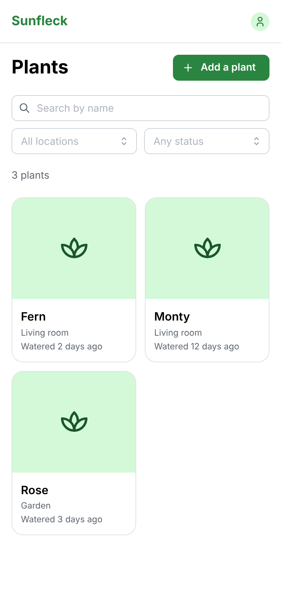

# Sunfleck

A self-hosted, open-source plant care app for hobbyists, for indoor and outdoor plants. It
tells you when each plant needs care, from its type, where it grows, its light, its pot, the
season and the weather, and learns from how you find the soil.

*A sunfleck is a brief patch of sunlight that reaches the forest floor through the canopy.*

<p align="center">
  
  
  
</p>

## Features

- **Your plants and where they grow**: sites on a map, indoor rooms and outdoor beds,
  windows and grow lights, pots and soil, photos.
- **Care that's predicted, not just scheduled**: watering and fertilizing intervals worked out
  from each plant's care profile, light, temperature, pot, season and hemisphere, with an
  explanation of why. Tell it whether the soil was too dry or still wet, and it adapts.
- **One tap on your phone**: a Today page with what's due, snooze and skip, a care timeline,
  and an app you can install on your home screen.
- **Reminders where you want them**: a daily digest and an evening reminder as notifications
  from the app itself, or through ntfy, Telegram, email, Discord, Signal and about 100 other
  services. Care for the next two weeks can also go in your calendar.
- **Weather-aware** (optional plugin, Open-Meteo): outdoor watering waits after rain and comes
  sooner in heat, with frost warnings.
- **Plant identification** (optional plugin, Pl@ntNet): identify a plant from a photo.
- **A care guide** of care profiles for over 300 genera and species, with common names.
- **For the whole household**: invite others as Admin, Gardener or Viewer; each chooses
  their language, units (metric or imperial) and notifications.
- **Yours**: self-hosted, export and import everything, no tracking. One Docker image, SQLite
  by default (PostgreSQL optional), runs on a Raspberry Pi.
- **Extensible**: a plugin system, and translatable.

## Install

With Docker:

```bash
mkdir sunfleck && cd sunfleck
curl -fsSLO https://raw.githubusercontent.com/mazelado/sunfleck/main/docker/compose.yaml
curl -fsSL https://raw.githubusercontent.com/mazelado/sunfleck/main/docker/env.example -o .env
# edit .env: at least SECRET_KEY (openssl rand -base64 48)
docker compose up -d
```

Then open <http://localhost:8000>. The [installation guide](docs/install.md) covers HTTPS
and your phone, email, backups, upgrades and every setting.

## Documentation

- [Installing Sunfleck](docs/install.md): setup, HTTPS, backups, upgrading
- [Using Sunfleck](docs/user-guide.md): places, plants, care, notifications, households
- [Development](docs/development.md): run it from the source code
- [Writing plugins](docs/plugins.md), [translating](docs/translating.md), and the
  [care dataset](data/care/README.md)
- [Roadmap](docs/roadmap.md): what's planned, and the release names
- [Technical plan](docs/technical-plan.md) and [style guide](docs/STYLE_GUIDE.md)

## About this project

Sunfleck is a household project, shared as-is: built for one home's plants and opened up in
case it's useful to others. Issues and pull requests are welcome, but there's no guaranteed
support or timeline. Much of the code was written with an AI coding assistant, and every
change is reviewed and tested before it's merged (see
[CONTRIBUTING.md](CONTRIBUTING.md#ai-assisted-contributions)). To report a security problem,
see [SECURITY.md](SECURITY.md).

## Contributing

Contributions are welcome, from code to translations and care profiles for more plants: see
[CONTRIBUTING.md](CONTRIBUTING.md), including our policy on AI-assisted contributions.
Everyone taking part is asked to follow the [code of conduct](CODE_OF_CONDUCT.md).

## License

Sunfleck is [AGPL-3.0](LICENSE). The care dataset (`data/care`) is
[CC BY-SA 4.0](data/care/LICENSE). Weather data by [Open-Meteo.com](https://open-meteo.com)
(CC BY 4.0); plant identification by [Pl@ntNet](https://plantnet.org).
